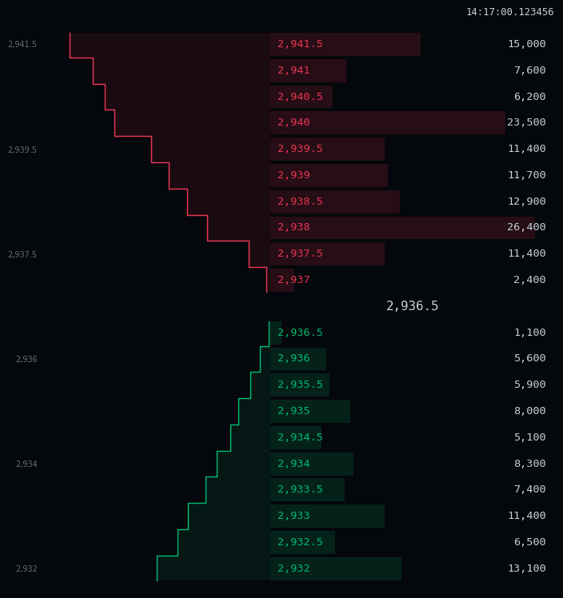
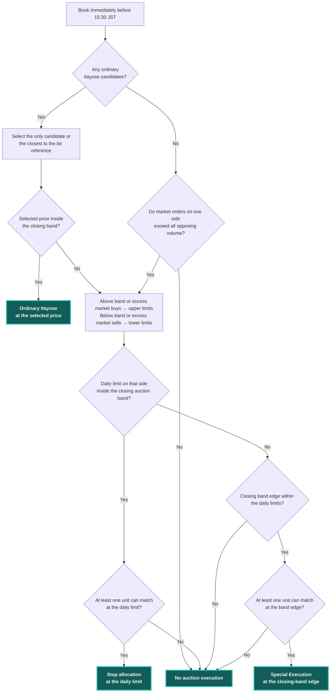

# TSE Order Book Reconstructor

This repo reconstructs the order book for securities on the Tokyo Stock Exchange from a historical FLEX Market-by-Order packet capture file. There are two main functionalites: 
1. **Reconstruct and replay the order book.** Rebuilds the book from individual order events, providing a replay that shows how bids and asks evolve for any stock in the capture.
2. **Recreate the TSE closing auction.** Apply ordinary Itayose, stop allocation, and Special Execution rules to the reconstructed pre-auction book to calculate the auction execution price and matched volume.

The repo handles parsing of the raw PCAP file, tracking of individual orders, aggregates bids and asks by price, and reconstructs the orderbook from any point in time.

Decode a capture once, then use the saved events to **replay a stock's book**, **export a snapshot**, or **calculate auction results for the captured stocks**.

## Setup

Use Python 3.10 or later and install [TShark](https://www.wireshark.org/download.html) (for PCAP parsing).

```bash
git clone https://github.com/williammho/TSE-Order-Book-Reconstructor.git
```

## Quick start

Set `TSE_DATA` to the directory for the PCAP file and reference CSVs. Use a single-day TSE FLEX MBO capture that starts with the first update for each issue.

### 1. Load a capture

```bash
TSE_DATA="$HOME/tse-data"
python main.py load "$TSE_DATA/YYYYDDMM_flex.pcap" "$TSE_DATA/events"
```

`load` extracts UDP payloads, decodes TSE FLEX messages, and writes one `.jsonl.gz` file per issue to the "events" directory, containing one market event per line. 

### 2. Replay or inspect a book

```bash
# Replay 10 seconds of Toyota (7203) at 2x speed
python main.py replay "$TSE_DATA/events" \
  --stock 7203 --start 14:17:00.123456 --duration 10 --speed 2

# Show a fixed snapshot
python main.py replay "$TSE_DATA/events" --stock 7203 --start 14:17:00

# Export a snapshot to CSV
python orderbook.py "$TSE_DATA/events" "$TSE_DATA/toyota_snapshot" \
  --stock 7203 --time 14:17:00.123456
```

The replay window shows the best 10 price levels per side by default, with cumulative depth on the left. Use `--levels` to change how many price levels are shown.




### 3. Calculate the closing auction

```bash
python main.py predict "$TSE_DATA/events" "$TSE_DATA/reference_20241225.csv" \
  "$TSE_DATA/predictions.csv"
```

The calculator uses a **15:30:00 JST exclusive cutoff**. The first prediction run saves these books under `events/books_preclose/`. 

The current auction calculator targets **2024**. Reconstruction and replay run directly from the event files, while prediction also needs a reference CSV. The reference file contains information regarding each stock: `stock`, `date`, `tick_table` (`topix500` or `other`), `trading_unit`, `daily_lower`, and `daily_upper`. The calculator derives the closing band from the book's reference price when available. The CSV can supply `closing_lower`, `closing_upper`, `tie_reference`, and `special_allowed` where required.

To verify predictions against the actual Itayose results, extract the **actual closes** from the capture. This comparison uses the reported auction price and calculates the executed volume from market event tags.

```bash
python itayose.py actuals "$TSE_DATA/events" "$TSE_DATA/actual_closes.csv"
python main.py predict "$TSE_DATA/events" "$TSE_DATA/reference_20241225.csv" \
  "$TSE_DATA/checked_predictions.csv" --actuals "$TSE_DATA/actual_closes.csv"
```

## Itayose decision tree

TSE has two bounds in place to prevent rapid fluctuation of prices: 1. **daily price limits** and the **closing band**. The **daily price limits** bound the prices for the entire trading day, with the center price determined by the previous day's close. The **closing band** bounds execution prices specifically for the closing auction. This band is calcualted as twice the renewal price interval above and below the pre-auction reference price (last executed trade price in continuous auction).

The calculator tests each valid tick within the daily limits. The following 3 conditions must be satisfied for a price to be valid during ordinary Itayose execution: 
1. All sell/buy market orders are executed
2. All limit orders to sell/buy at prices lower/higher than the execution price (i.e. better-priced bids/asks) must be executed
3. At the execution prie, either all sell OR all buy orders must be executed

If multiple prices satisfy these conditions, TSE executes at the price that is closest to the pre-auction reference price (See: [TSE Business Regulations (2025), Rule 12(6)](https://www.jpx.co.jp/english/rules-participants/rules/regulations/tvdivq0000001vyt-att/business_regs_20250507.pdf#page=9))

If no price can satisfy the ordinary Itayose requirements, TSE can execute using either **Special execution** or **Stop allocation at the daily limit**. The following flowcharts depicts how the execution method is decided. Note that if requirements for all 3 are unsatisfied, no Itayose auction execution occurs. 



For either fallback, eligible volume includes market orders and limit orders at the tested price or better. Matched volume is calculated as **min(eligible buy orders, eligible sell orders)**.

As an example, on December 25, 2024, the calculator matched the recorded price and volume for **3,813** instruments with an auction execution (includes ordinary Itayose, Stop Allocation, and Special Execution). The other **599** had no recorded auction execution.

## File information

| File | Role |
| --- | --- |
| `main.py` | Runs the load, predict, and replay workflows. |
| `pcap.py` | Extracts UDP payloads and capture fields into a TSV. |
| `flex.py` | Decodes FLEX messages into events grouped by issue code. |
| `orderbook.py` | Reconstructs the orderbook. |
| `itayose.py` | Calculates the closing auction outcome and checks it against captured executions. |
| `playback.py` | Replays the book and cumulative depth in a popup window. |
